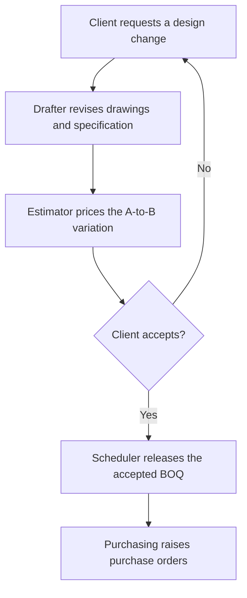

# House Sync

**One design change, instantly coordinated across drawings, cost variation, BOQ and purchase orders.**

## The problem

A client moves a wall before construction. The drafter revises the drawings and the estimator prices the variation. If the client accepts, the scheduler prepares the bill of quantities (BOQ) and purchasing raises orders. If they decline, the cycle starts again. Re-keying the change at each handoff can add days and leave drawings, costs and orders on different revisions.

## What House Sync does

The drafter updates the shared model to regenerate the drawings and specification. The estimator compares the previous revision (A) with the proposal (B) and prepares a client variation quote. When the client accepts, the scheduler releases B's BOQ and purchasing uses its lines to prepare draft orders. Each document identifies its source revision. The quote identifies both A and B.

## Who it’s for

Australian custom and semi-custom home builders, where nearly every home is tailored to the client and frequent variations make repeated handoffs costly.

## Workflow

## Current status

AUD trade pricing, the CSV rate library, room-based BOQs, draft purchase orders and client variation quotes are available on `main`. House Sync remains a local concept application with **illustrative AUD rates, not a tender estimate**.

The model supports a single-storey rectangular shell, optional orthogonal partitions, stable named rooms and room finish selections. A successful update coordinates the 3D model, IFC, dimensioned drawings, technical specification and grouped BOQ. Saved A/B revisions drive the internal cost comparison and client variation quote. Purchasing exports draft orders from the selected revision's saved BOQ.

The BOQ is ready for review as soon as the drafter updates the design. The builder records client acceptance, releases the accepted BOQ and issues supplier orders through their existing process.

## How the four roles work together

| Role | Work in House Sync | Handoff |
|---|---|---|
| Drafter | Edit the shell, partitions, openings and room finishes. Check geometry and access, then publish the revision | Drawings, specification, IFC and model revision for estimating |
| Estimator | Compare A with B and review quantities, rates, margin, fees, credits and allowances | Client variation quote and private itemised breakdown |
| Scheduler | Confirm which revision the client accepted and release its shell and room BOQ | Quantities and revision ID for purchasing |
| Purchasing | Check units and gross quantities. Download individual draft orders or the full ZIP and enter supplier and delivery details | Orders ready for the builder to issue |

Built on [homespec](https://github.com/maccman/homespec) by Alex MacCaw. The original MIT licence, source, examples and Git history are retained. Read the [original homespec README](HOMESPEC_README.md) for its compiler and Blender workflows.

## Available capabilities

- A single-storey rectangular shell with a flat roof. The default design opens as one room with one door and two windows. Orthogonal partitions divide the shell into named rooms.
- Editable clear internal length/width, wall height/thickness, paint name/colour and coat count, currency, per-item wastage and optional rate overrides. A versioned CSV library supplies one rate and source/date for each of the eleven BOQ items.
- A primary **Plan editor** for selecting walls, dragging north/east resize grips, editing dimensions, and adding, moving, resizing or deleting doors/windows. Grid snapping, pan/zoom, measurement, undo/redo, geometry checks and a draft change review support direct editing.
- An interactive 3D model: orbit, zoom, select elements, and show/hide the roof.
- Eleven BOQ rate codes in Excel/CSV, grouped into shell and room takeoffs, including floor finish, ceiling, skirting, internal plaster/render and external render. Net quantity, wastage, gross priced quantity and each item's rate basis remain visible. Technical specification in Word/PDF; floor plan and south/east elevations in SVG/PDF; model in IFC.
- Save/reopen a design as JSON. Previous generated revisions remain available locally.
- Every output identifies the same content-based revision. Pending edits disable downloads until regeneration.
- A **Changes & cost** tab compares saved revision A with revision B, records descriptions of the changes, and shows before/after BOQ quantities, rates, amounts, additions, omissions and the net estimate difference. Reports are available in Excel, CSV, PDF and JSON.
- A **Purchasing** tab downloads one fillable draft purchase-order PDF per saved BOQ item, or all item PDFs in a ZIP. It uses the saved revision's quantities and prices.
- Saved builder pricing settings for one combined overhead and margin markup, a fixed administration fee, credit treatment and quote validity; separately identified prime cost (PC) and provisional sum (PS) allowances.
- A client variation quote PDF with acceptance fields, plus a separate internal itemised breakdown. The saved comparison retains the issue date and both source revisions.

## Edit directly from the plan

The **Plan editor** is the main workspace. Plan measurements and opening positions are in millimetres; the sidebar dimensions are in metres.

1. Select a wall or dimension to enter exact sizes, or drag the north/east shell grips. The rectangular shell stays square and its south-west datum stays fixed.
2. Select a door/window to drag it along its host wall or edit its start, size, sill and host in the inspector. Use the door/window tools to add openings and delete a selected opening to remove it.
3. Use the snap grid for precise placement, pan/zoom or fit the plan, and undo/redo draft edits. A centred opening follows the wall centre until you give it a fixed start position.
4. Review the draft changes and resolve the geometry checks. Openings need 100 mm from wall ends, a 100 mm head clearance, and a 100 mm gap from another opening on the same wall. These are application constraints, not a building-code assessment.
5. Select **Update house & documents** to compile the design, update the 3D model and coordinated exports, and record the A-to-B cost change. The **Changes & cost** tab then provides the client variation quote, a separate internal itemised breakdown and the internal variation order PDF.

Draft plan edits do not issue documents. Downloads of the current document set remain disabled until a successful update; a failed validation/build preserves the preceding saved revision. Use the **Partition** tool to place two grid-snapped endpoints on the shell or other partitions. Select a partition to move it, drag either end grip, or edit its thickness, height and wall type. A new partition can temporarily leave a room inaccessible. Place a door on the new wall and review the application checks before updating.

Select a derived room to enter its name and floor, ceiling, skirting or paint finish. Clear a finish to inherit the project allowance. The room follows moves of its bounding walls while its boundary identities stay the same. Splitting or merging rooms can create new identities. The plan, room finish schedule and BOQ identify the rooms saved in each revision. The variation order records partition and room edits by ID.

## Capture a change from A to B

Every successful update preserves the previous design and automatically creates a comparison with the new design. Open **Changes & cost** to review the last transition, or select any two saved revisions and choose **Compare revisions**. Each report identifies its two source revisions and is saved locally alongside the revision history. Reopening the application preserves these records.

**Changes & cost** provides a client variation quote and a separate internal itemised breakdown. The internal variation order, Excel, CSV, PDF and JSON cost reports remain available to the estimator.

The cost comparison reconciles the saved BOQ amounts. It separates changes in gross quantity (including coats and wastage) from changes in rates. Where both revisions record the rate basis, it also separates library changes from design overrides. A paint colour change at the same quantity and rate has zero cost. Earlier BOQs retain their recorded amounts. Revisions in different currencies cannot be compared. Two historical revisions in the same foreign currency can still be compared at cost. Client quotes use AUD.

The default 10 x 8 m design has an illustrative subtotal of **AUD 53,330.22**. Increasing its length to 12 m at the same rates, two paint coats and default wastage gives **AUD 61,640.22**, an **AUD 8,310.00 increase**. These are **illustrative AUD rates, not a tender estimate**. A paint colour change at the same quantity and rate is recorded with **zero cost difference**; the application does not invent a product price for a selected screen colour.

The cost comparison covers the modelled BOQ scope. Demolition, rework, abortive work, fees, taxes and programme effects are excluded unless separately modelled. The client quote separately applies the saved commercial settings and allowance movements. It is not a record of contractual approval.

## Prepare a client variation quote

1. In the estimator sidebar, open **Variation quote pricing**. Enter the builder's name and a plain-English description for the client. Review the proposed revision's combined overhead and margin, fixed administration fee, credit treatment and validity period.
2. Add a **prime cost (PC)** item for a selection still to be made, such as a tap set, or a **provisional sum (PS)** for work whose scope is still uncertain. Enter the allowance excluding GST and a note the client can read. Enter only scope additional to the measured BOQ. The quote shows the previous and proposed allowance and prices the difference once.
3. Select **Update house & documents**. In **Changes & cost**, choose the previous revision as A and the proposal as B. B supplies the pricing settings for this quote. Check the **Internal itemised breakdown PDF** for quantities, rates, their sources and allowance movements.
4. Share the **Client variation quote PDF** for acceptance. It includes the builder name and logo placeholders, scope, allowance movements, price, issue and expiry dates, and fields for the client's name, signature and date. The first preparation fixes the issue date in UTC. Validity defaults to 14 calendar days. Reopening the saved quote retains its dates, settings and PDFs after later edits.

### Worked quote for extending the house from 10 m to 12 m

With the supplied **illustrative AUD rates, not a tender estimate**, the 10 × 8 m house has a BOQ subtotal of AUD 53,330.22. Extending it to 12 × 8 m produces AUD 61,640.22. The table shows the generated client quote with default settings, two paint coats, default wastage and no PC or PS changes.

| Variation component | AUD |
|---|---:|
| Measured cost increase | 8,310.00 |
| Credits for omissions | 0.00 |
| Combined overhead and margin (20% markup on cost) | 1,662.00 |
| Fixed administration fee | 0.00 |
| **Subtotal excluding GST** | **9,972.00** |
| GST at 10% | 997.20 |
| **Client variation including GST** | **10,969.20** |

The 20% is one illustrative markup on cost. A fixed fee of AUD 150 would bring the same quote to **AUD 11,134.20 including GST**. The fee applies once when a measured item or allowance changes in value, including a credit-only variation. It attracts GST and carries no markup. A change to wording alone attracts no fee.

Adding a PC allowance of AUD 500 and a PS allowance of AUD 1,000 to revision B lifts the cost difference to AUD 9,810.00. With the default fee and markup, the quote becomes **AUD 12,949.20 including GST**. The measured BOQ subtotal for B stays at AUD 61,640.22.

Reversing the extension with the default zero fee gives a **credit of AUD 9,141.00 including GST** under **Credit at cost**. Selecting **Credit including margin** also returns the markup, increasing the credit to **AUD 10,969.20**. For a mixture of additions and omissions, the quote calculates markup on additions and applies the selected treatment to credits before calculating GST.

### Worked quote for adding a study

Use the two-room partition and access door in the worked takeoff below, with the selected room descriptions and unchanged trade rates, the checked-in AUD library, no project overrides, a 20% combined markup, zero administration fee and no PC/PS changes. Revision A is the original 10 × 8 m room; revision B has partition P1 and its door. The BOQ rises from AUD 53,330.22 to AUD 57,038.34.

| Variation component | AUD |
|---|---:|
| Additions at cost | 3,803.12 |
| Credits at cost | (95.00) |
| **Net measured cost change** | **3,708.12** |
| Combined overhead and margin on additions | 760.62 |
| Fixed administration fee | 0.00 |
| **Subtotal excluding GST** | **4,468.74** |
| GST at 10% | 446.87 |
| **Client variation including GST** | **4,915.61** |

Selecting **Credit including margin** also returns AUD 19.00 of markup with the credits, reducing the same quote to **AUD 4,894.71 including GST**. Reversing the design gives a credit of **AUD 4,058.03** with credits at cost, or **AUD 4,894.71** with markup returned. These figures use the recorded additions and credits separately. Equivalent finish scope continues across the change from shared to room-grouped BOQ rows.

### Continue the room design

Keeping P1 fixed at x = 4000 mm while extending the two-room shell from 10 m to 12 m raises its BOQ from **AUD 57,038.34 to AUD 65,348.34**. The Study remains 31.600 m² and Living grows from 47.600 m² to 63.600 m². The cost increase is AUD 8,310.00 and the default client quote is **AUD 10,969.20 including GST**. Both revisions produce eighteen draft purchase orders from their complete saved BOQs.

Adding P2 to the original two-room 10 × 8 m design produces the three-room T-junction example below. That transition has AUD 2,905.22 of additions and AUD 70.66 of credits, giving a net cost change of AUD 2,834.56. With the same 20% markup, zero fee and credits at cost, the client variation is **AUD 3,757.16 including GST**. Its full saved BOQ is AUD 59,872.90 and produces twenty-four draft purchase orders.

## Prepare draft purchase orders

Open **Purchasing** after a successful house update. Use **Download draft PO PDF** for one item, or **Download all draft POs (ZIP)** for the complete set. The default BOQ produces eleven item PDFs. The verified two-room worked example produces eighteen and the three-room example twenty-four. Older saved revisions use the BOQ rows they actually contain.

The set covers the selected revision's complete BOQ and is separate from the A-to-B client variation quote. Each PDF identifies the saved house revision and has a code-based PO reference. Its description, gross priced quantity, unit, rate, currency and amount come from that revision's saved BOQ. The exporter does not read today's library to reprice an older revision. For older BOQs without a separate gross quantity field, their saved priced quantity remains the basis.

Quantities retain their BOQ pricing units. For example, a paint quantity expressed in m2 per coat is not a paint volume; the application does not infer tins, packs, litres, coverage rates or supplier order increments. Default prices remain **illustrative AUD rates, not a tender estimate**.

After downloading, open the PDF in a viewer that supports fillable forms and enter the buyer, supplier, required-by, delivery and approval details. These are draft fields for review; filling them does not update the model or approve/send an order. The application does not contact suppliers or place purchases. Pending house edits must be saved before downloading a coordinated purchasing set.

## Run on Windows

Prerequisites: Git, [uv](https://docs.astral.sh/uv/), Python 3.12, and Node.js/npm. The initial installation needs internet access. Subsequent editing and export generation use local dependencies, without Blender, an AI API key, or an external SVG converter.

~~~powershell
git clone https://github.com/RichardAi88/house-sync.git
cd house-sync
uv sync --frozen --extra dev --python 3.12 --cache-dir .cache/uv
npm.cmd ci --cache .cache/npm
.venv\Scripts\python.exe -m housesync.server --open
~~~

After setup, double-click **start-house-sync.cmd**. Open **http://127.0.0.1:8766**. If the editor is already running, the launcher opens it. Keep the launcher running while using the editor; Ctrl+C stops it. GitHub stores source and history; this backend runs locally on this PC's loopback interface.

On macOS/Linux use `.venv/bin/python -m housesync.server --open` after the same uv/npm setup. Initial local verification was on Windows with Python 3.12.

## Maintain rates and overrides

The editable default rate library is [`rates/rates_aud.csv`](rates/rates_aud.csv). It has one row for each BOQ code, including independent `DOOR` and `WINDOW` allowances. The checked-in values are **illustrative AUD rates, not a tender estimate** and do not represent supplier quotes or researched market prices. Every seeded row has `source` set to `illustrative`; its notes retain the disclaimer.

| CSV column | Meaning |
|---|---|
| `code` | Stable BOQ code, such as `FLOOR_FINISH`; each of the eleven codes must occur once |
| `description` | Description of the rate allowance |
| `unit` | Item's measurement unit: `m2`, `m3`, `m` or `each`, matching its BOQ code |
| `rate` | Positive unit rate up to 1,000,000. Coats and wastage are applied to the measured quantity. |
| `currency` | One uppercase three-letter currency for the complete library; the default file uses `AUD` |
| `source` | Actual source or an explicit illustrative label |
| `effective_date` | Date of that rate's pricing basis, in `YYYY-MM-DD` format |
| `notes` | Scope, exclusions or other rate qualifications |

1. Edit the CSV in a text editor or spreadsheet application and save it as UTF-8 CSV. Keep all codes and their expected units, and keep one currency throughout the file. Supply genuine source/date information when replacing an illustrative allowance; the application does not obtain quotes for you.
2. Open the editor's **Rates** tab and select **Refresh rate library**. Review the loaded values, sources, dates and notes. The tab identifies the current library SHA-256 and the library saved with the displayed revision.
3. Edit an item's project override directly in the **Rates** panel or in the sidebar's **Rate overrides**. Leave the field blank to follow its library row; an explicit `0` is a zero-cost override. **Use library** clears that item's override from either location. The two controls edit the same draft value. Record the source/date for project overrides in the sidebar.
4. Select **Update house & documents** to generate the coordinated model and documents at the reviewed rates. Refreshing the library or editing an override leaves the draft pending; it does not rewrite earlier snapshots.

For a separate project library, start the server with an explicit file:

~~~powershell
.venv\Scripts\python.exe -m housesync.server --rates C:\path\to\project-rates.csv --open
~~~

The loader rejects invalid rows with a CSV line reference. A build needs either a library matching the design currency or explicit overrides for all eleven items; no exchange rate is assumed. A packaged installation includes the default CSV, so it does not depend on the current working directory.

For example, the default 80 m2 floor finish has 10% wastage, giving **88 m2** gross. At AUD 65/m2 its amount is **AUD 5,720.00**. Changing the library rate to 70 with no override gives **AUD 6,160.00**, a **AUD 440.00 library rate effect**. Keeping the library at 65 and entering a 70 override gives the same amount, attributed to the override. If an override already pins the item at 70, changing the underlying library row does not change that item's effective rate.

Each generated revision saves the library's full SHA-256 over its raw CSV bytes and its row data, plus the effective rates and their provenance. BOQ and specification exports identify whether each effective rate came from the library or an override, with the source/date. A source/date-only CSV edit changes the library fingerprint and may produce a new revision while leaving costs unchanged. Quantity, library and override effects are calculated in that order, with rounding reconciled to the saved item amounts.

Existing designs with explicit stored rates retain those values as overrides rather than silently adopting the current library. Older pre-finishes designs in another currency may not contain prices for every new trade: they can be opened, but missing values or a matching-currency library must be supplied before building. Saved BOQs remain authoritative for historical comparisons, and different currencies still cannot be compared.

## Generated example guide

Use the checked-in AUD library, two paint coats, default wastage and no project overrides to reproduce the detailed examples below. BOQ amounts are measured internal costs excluding GST. Client quote amounts separately apply the proposed revision's commercial settings.

| Example | Clear room finish area | BOQ subtotal excluding GST | Client quote example |
|---|---:|---:|---|
| Default 10 × 8 m shell, one room | 80.000 m² | AUD 53,330.22 | Baseline revision A |
| Extend the shell to 12 × 8 m | 96.000 m² | AUD 61,640.22 | AUD 10,969.20 including GST for the A-to-B variation with default commercial settings |
| Add P1 and its access door for two rooms | 79.200 m² | AUD 57,038.34 | AUD 4,915.61 including GST from the default one-room revision, with credits at cost |
| Add P2 and its access door for three rooms | 78.605 m² | AUD 59,872.90 | AUD 8,672.79 including GST from the default one-room revision, with credits at cost |
| Extend the two-room layout to 12 × 8 m, keeping P1 at x = 4 m | 95.200 m² | AUD 65,348.34 | AUD 10,969.20 including GST from the two-room 10 × 8 m revision |

The worked quote section also shows a fixed fee, PC/PS movements and credit treatment. A room variation can contain both additions and omissions. The quote uses the saved item movements to apply the selected margin treatment to each.

## A change you can verify

The default house has **10 x 8 m clear internal dimensions**, 200 mm walls and 3 m wall height. One 1.0 x 2.1 m door and two 1.5 x 1.2 m windows deduct **5.7 m2** from each set of wall faces. These hand calculations check the compiled model quantities:

| Measured quantity | Default 10 x 8 m | Length changed to 12 x 8 m |
|---|---:|---:|
| Clear floor / floor finish / ceiling area | 80.000 m2 | 96.000 m2 |
| Net wall volume | 20.940 m3 | 23.340 m3 |
| Flat roof area, including overhang | 99.000 m2 | 117.000 m2 |
| Skirting: clear internal perimeter less door widths | 35.000 m | 39.000 m |
| Internal plaster/render: internal perimeter x height less openings | 102.300 m2 | 114.300 m2 |
| External render: external perimeter x height less openings | 107.100 m2 | 119.100 m2 |
| Net paint area: internal plus external wall faces | 209.400 m2 | 233.400 m2 |
| Painted quantity at 2 coats, before wastage | 418.800 m2 | 466.800 m2 |

For example, the default internal wall faces are `2 x (10 + 8) x 3 - 5.7 = 102.3 m2`. The external faces use the 10.4 x 8.4 m external footprint: `2 x (10.4 + 8.4) x 3 - 5.7 = 107.1 m2`. Skirting is `2 x (10 + 8) - 1.0 = 35 m`. These equations are independent checks; production quantities come from the compiled model.

| BOQ item | Default rate (AUD/unit) | Default wastage | 10 x 8 m amount (AUD) | 12 x 8 m amount (AUD) | Change (AUD) |
|---|---:|---:|---:|---:|---:|
| Floor slab, m2 | 95.00 | 0% | 7,600.00 | 9,120.00 | +1,520.00 |
| Masonry walls, m3 | 380.00 | 0% | 7,957.20 | 8,869.20 | +912.00 |
| Flat roof, m2 | 145.00 | 0% | 14,355.00 | 16,965.00 | +2,610.00 |
| Wall painting, m2 per coat | 9.00 | 0% | 3,769.20 | 4,201.20 | +432.00 |
| Door allowance, each | 650.00 | 0% | 650.00 | 650.00 | 0.00 |
| Window allowance, each | 650.00 | 0% | 1,300.00 | 1,300.00 | 0.00 |
| Floor finish, m2 | 65.00 | 10% | 5,720.00 | 6,864.00 | +1,144.00 |
| Ceiling, m2 | 45.00 | 5% | 3,780.00 | 4,536.00 | +756.00 |
| Skirting, m | 18.00 | 10% | 693.00 | 772.20 | +79.20 |
| Internal plaster/render, m2 | 28.00 | 5% | 3,007.62 | 3,360.42 | +352.80 |
| External render, m2 | 40.00 | 5% | 4,498.20 | 5,002.20 | +504.00 |
| **Subtotal** | | | **53,330.22** | **61,640.22** | **+8,310.00** |

The default library gives doors and windows the same AUD 650 allowance in separate rows; they can be priced independently. Changing only the paint colour updates the model and finish descriptions while preserving measured quantities. Coat count, each item's wastage and rate overrides can be edited independently. The worked totals use the checked-in library with no overrides.

## Worked partition takeoff

Start with the default 10 × 8 m clear shell, 3 m walls and the original exterior openings. Dimensions below use the south-west inside corner as the origin. Run a 100 mm partition P1 from (4000, 0) to (4000, 8000) mm. Give it a 1000 × 2100 mm door starting 1500 mm from its first endpoint. For a third room, add a 100 mm partition P2 from (4000, 3000) to (10000, 3000) mm and a second 1000 × 2100 mm internal door starting 1500 mm from P2's first endpoint.

In the generated check, the west room is named **Study** and the east room **Living**. With P2 added, the south-east room is **Kitchen** and the north-east room **Living**. All rooms use the descriptive floor selection **Selected oak floor** and paint selection **Selected warm white**, with ceiling and skirting inherited. These descriptive selections use the same illustrative trade rates.

| Layout and room | Clear dimensions (m) | Floor and ceiling (m² each) | Clear perimeter (m) | Skirting (m) | Internal plaster and measured paint (m² each) |
|---|---|---:|---:|---:|---:|
| Both layouts · west | 3.95 × 8.00 | 31.6000 | 23.90 | 22.90 | 69.60 |
| Two rooms · east | 5.95 × 8.00 | 47.6000 | 27.90 | 25.90 | 75.90 |
| Three rooms · south-east | 5.95 × 2.95 | 17.5525 | 17.80 | 14.80 | 47.10 |
| Three rooms · north-east | 5.95 × 4.95 | 29.4525 | 21.80 | 20.80 | 59.70 |

P1 contributes `(8 × 3 − 1 × 2.1) × 0.1 = 2.190 m³`. At the T-junction P2 adds `(5.95 × 3 − 1 × 2.1) × 0.1 = 1.575 m³`. The slab stays at 80 m². Clear floor finishes total 79.200 m² with P1 and 78.605 m² with both walls. Exterior render stays at 107.100 m². At the checked-in AUD rates, including two paint coats and default wastage, the two-room subtotal is **AUD 57,038.34** and the three-room subtotal is **AUD 59,872.90**.

The shell group holds the slab, roof, shell wall, individual partitions, openings and exterior finishes. Each room has its own measured finishes and subtotal. Partition volume uses the existing `WALL` rate and room lines use their existing trade rate codes. Naming a product in a finish description does not supply a new price.

## Measurement and document scope

Model dimensions are in millimetres; browser geometry is in metres. Drawings distinguish internal clear dimensions from external overall dimensions. Wall corners are counted once. All take-off quantities are derived from compiled geometry, including hosted opening dimensions:

- Floor finish and ceiling use the clear internal room area. Ceiling is an area allowance over that footprint; no ceiling framing or suspended system is modelled.
- Each room takes skirting around its clear perimeter, less the door widths along that room. An internal door interrupts skirting on both room faces and counts as one door product.
- Internal plaster/render and external render use their respective net vertical wall faces and deduct all modelled door/window opening voids. They are separate trades from the structural masonry volume.
- Painting uses both sets of net wall faces. The description retains the measured net area; the editable coat count defaults to **2**. `Net painted quantity = measured area x coats`. Ceiling, floor, roof, reveals, sills and soffits are excluded from painting.
- Each BOQ item has an editable wastage percentage. `Gross quantity = net quantity x (1 + wastage / 100)` and `Amount = gross quantity x rate`, rounded half-up to cents per row. Paint defaults to 0% wastage, with coats applied separately. Wastage is a pricing allowance, not a change to model dimensions.
- The roof includes a 300 mm overhang. Door/window rows count parent products once, excluding emitted frame, leaf and glazing parts.

New designs default to **AUD**. The library rates are labelled **illustrative AUD rates, not a tender estimate**; they are demonstration inputs, not supplier quotes or market research. Each CSV row supplies its own source and effective date; the demonstration date is **2026-11-17**. Project overrides retain their own source/date. Loading an old design preserves its explicitly stored rates and currency. No currency conversion is inferred, and revisions in different currencies cannot be compared.

The BOQ now includes the slab, masonry, flat roof, opening allowances and five finishing trades with wall painting. It remains a concept estimate: taxes, preliminaries, foundations, reinforcement, drainage, services, waterproofing, demolition/rework, fees and programme effects are excluded. Product systems, preparation, thicknesses for finishing layers, construction details and regulatory performance require project-specific selections. The specification is a draft technical schedule for development alongside a contract. The demonstration does not claim that homespec's building guideline or regulatory checks have been run.

BOQ subtotals are internal measured costs excluding GST. The client quote is a separate commercial calculation: it prices saved A-to-B cost movements and PC/PS allowance changes, applies the proposed revision's markup and fixed fee, then applies signed 10% GST. Only AUD revision pairs produce client quotes; same-currency historical comparisons remain available in other currencies. Private itemised trade rates and pricing provenance stay in the internal PDF. The client PDF contains the approved commercial totals, plain-English scope and client-facing allowance notes.

## Files and development

| Path | Purpose |
|---|---|
| `housesync/schema.py` | Validated house parameters, legacy prices and rate overrides |
| `rates/rates_aud.csv` | Editable, versioned default rate library with source/date per BOQ item |
| `housesync/rates.py` | CSV validation, library fingerprint and snapshot data |
| `housesync/layout.py` | Orthogonal regions, stable room IDs, finish selections and application checks |
| `housesync/room_geometry.py` | Compiled room solids and wall-face takeoff |
| `housesync/room_boq.py` | Shell and room BOQ lines, allowances and subtotals |
| `housesync/engine.py` | Homespec geometry/IR, quantities, BOQ, IFC and browser mesh |
| `housesync/documents.py` | Coordinated Excel, Word, PDF and SVG exports |
| `housesync/changes.py` | Described A-to-B revision comparison and change-cost report exports |
| `housesync/quotes.py` | Signed variation pricing, allowance movements and client-safe quote data |
| `housesync/quote_documents.py` | Client quote and separate internal itemised PDF |
| `housesync/purchasing.py` | Draft purchase orders from saved BOQ rows |
| `housesync/server.py` | Local server and immutable revision, comparison and quote publication |
| `housesync/static/` | Browser editor and Three.js viewer |
| `out/house-sync/<revision>/` | Generated files; excluded from Git |
| [Project plan](docs/house-sync-plan.md) | Scope, verification and next features |
| [Decisions](docs/house-sync-decisions.md) | Geometry, measurement and revision decisions |

~~~powershell
$houseTests = (Get-ChildItem tests/test_housesync*.py).FullName
.venv\Scripts\python.exe -m pytest @houseTests tests/test_rate_library.py -q
.venv\Scripts\ruff.exe check .
Get-ChildItem housesync/static -Filter *.js | ForEach-Object { node --check $_.FullName; if ($LASTEXITCODE) { exit $LASTEXITCODE } }
$editorTests = (Get-ChildItem tests/*.test.mjs).FullName
node --test @editorTests
~~~

Windows uses build123d 0.10 to avoid an import failure caused by scanning an invalid Windows font with 0.11. The generation lock includes a Windows msvcrt implementation. Linux/macOS use build123d 0.11, preserving the advanced geometry API and Python 3.13 compatibility used by the upstream test suite.

Verification for the rate library passed **196 House Sync Python tests**, **38 JavaScript tests**, repository-wide Ruff and syntax checks for every browser JavaScript file. A design saved by the preceding AUD version retained its AUD 54,669.22 subtotal and reported zero changes after all library prices were increased by 20%. The variation order PDF was rendered and the Excel BOQ recalculated.

In a live Chrome session, overriding the slab rate from AUD 95 to 105 increased the estimate by AUD 800. Resetting the override restored the original subtotal. Updating the CSV slab rate to AUD 115 produced an AUD 1,600 library effect and a zero override effect.

On merged `main` (`04ed75b`), the full Windows non-Blender run had 830 passes, 17 failures and three errors. All 20 affected test IDs match the pre-integration baseline. Seven involve symlink privileges, twelve involve advanced geometry and one involves a retained-camera source hash. GitHub Actions passed all 850 non-Blender tests on Ubuntu and all nine Blender integration tests.

The upstream library_room build was verified on this PC with **51 checks passed, zero failed**. Local tests independently compare quantities with rectangular-shell calculations and IFC geometry. Generated PDFs and the recalculated spreadsheet were visually inspected. Word package/content tests pass; native Word/LibreOffice visual rendering was unavailable. Six upstream reliability tests that create symbolic links were blocked by the Windows account's symlink privilege; they are not reported as passes.

### Combined application verification

The combined application passed **448 House Sync Python tests and 59 JavaScript tests on Windows**. Repository-wide Ruff and syntax checks for every browser JavaScript file passed. The tests cover compiled rooms and IFC, rate and allowance changes, client/internal quote separation, purchasing, historical compatibility and retained output snapshots. An integrated generation check reproduced the one-room, two-room and three-room figures above, plus the fixed-partition 10 m to 12 m extension. Each 11-, 18- and 24-file purchase-order ZIP passed its integrity check. Every PDF retained its archived gross quantity, rate, amount and revision, and the PO amounts reconciled to that revision's BOQ. Client and internal PDFs were separately checked for each quoted transition. Descriptive finish labels and source/date-only rate updates preserved the quote price when the applied rates were unchanged.

### Earlier feature verification records

The room feature in PR #4 recorded 300 application/rate-library Python tests and 47 JavaScript tests passing on Windows, including T-junctions, differing heights, room holes, named IFC spaces, invalid layouts and legacy comparisons. Its Chrome review covered a partition, hosted access door, room finishes and grouped BOQ.

The quote feature in PR #6 recorded 318 House Sync Python tests and 46 JavaScript tests passing on Windows. It checked signed credits, allowance movements, client/internal PDF separation, immutable quote dates/files after later changes and a Chrome quote workflow. These branch-specific counts are retained as historical evidence. The current integration verification is recorded separately.

## Plan editing audit evidence

The edited-shell audit fixture compiled with zero clashes and 28 passing upstream checks. Its glazing ratio was 5.6% against the upstream project's 10% guideline, which remains an unresolved concept finding. It is not represented as a statutory requirement. The optional Blender dressed-scene audit was attempted but could not run because Blender is unavailable; furniture/circulation and building-code compliance are not certified by the editor's geometry checks.

The original plan editing audit covered plan logic, API/build/export tests and visual checks of the generated drawing and specification PDFs. It did not include a live pointer interaction review.

## Licence

MIT. See [LICENSE](LICENSE). Dependencies retain their respective licences. This project acknowledges homespec's original authorship and does not imply endorsement by its author.
